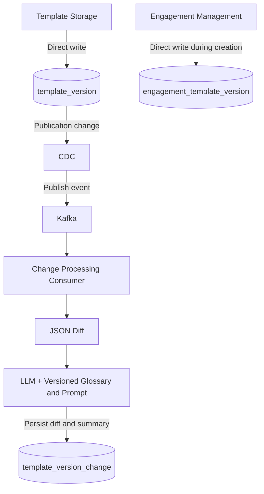
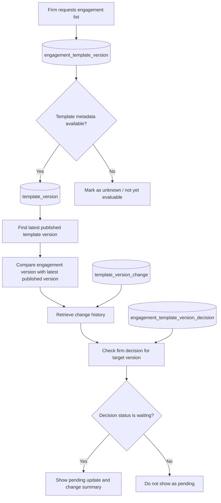
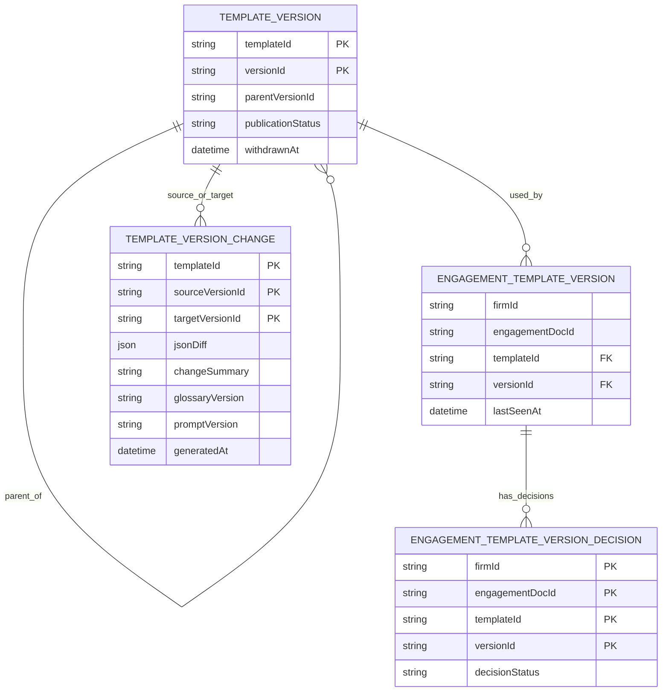
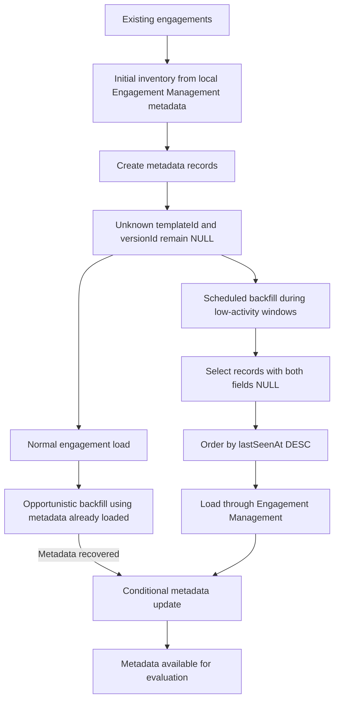

# Caseware — Architecture Design

**Part 1: Template Updates and Engagement Visibility**

## 1. Objective and scope

The objective is to provide firms with visibility into Product Template updates that may affect their existing engagements. When a new template version is published, Caseware must make the update and its change summary available so that firms can decide whether to accept or decline it.

The solution must support approximately 800,000 active engagements across 4,000 firms and 40 products. It must also preserve historical information so that a change summary presented in March can still be explained during a regulatory review in November.

The design deliberately avoids loading Engagement Files to determine whether updates are pending. Those files remain on the firms' own servers, and loading an engagement through Engagement Management takes approximately one minute.

The scope covers:
- Recording template versions and engagement template metadata.
- Generating and storing version-to-version change information.
- Identifying pending updates when engagements are queried.
- Recording firm decisions.
- Supporting historical traceability, backfill, and reliable asynchronous processing.

Applying updated template content to an engagement is outside the scope.

## 2. Architecture overview

The solution uses direct writes for the two primary data flows and asynchronous processing for the generation of template change information.

**Template publication**

_Template Storage_ writes the new version and its metadata directly into `template_version`. CDC detects the effective publication change and publishes an event to Kafka. A consumer processes the event, obtains the JSON difference between versions, generates a human-readable summary using the LLM and a versioned _glossary.md_, and stores the result in `template_version_change`.

**Engagement creation**

_Engagement Management_ writes the engagement's template ID and creation version directly into `engagement_template_version`, as part of its normal creation flow.

**Engagement listing**

When a firm requests its engagements, Caseware compares the template version associated with each engagement against the latest published version. It retrieves the corresponding change history and checks the firm's decisions. Only updates with a `waiting` decision are presented as pending.

This evaluation happens on demand. The system does not update every engagement when a template is published, nor does it persist a separate pending-update indicator.

## 3. Data model and ownership

The design uses four data structures.

| Structure | Purpose | Ownership / writes |
|---|---|---|
| `template_version` | Stores template versions and publication metadata | Template Storage |
| `engagement_template_version` | Stores engagement-to-template/version metadata | Engagement Management |
| `template_version_change` | Stores JSON differences and human-readable summaries | Asynchronous consumer |
| `engagement_template_version_decision` | Stores the firm's decision for each engagement and target version | Engagement Management / decision flow |

### `template_version`

This is the existing template-version storage, extended with publication and version relationship metadata.

- `templateId`
- `versionId`
- `parentVersionId` (nullable)
- `publicationStatus`
- `withdrawnAt` (nullable)

The primary key is `(templateId, versionId)`. A parent must belong to the same template and exist. Existing versions are not overwritten. A withdrawn version remains available as historical data; withdrawal does not remove its relationships or invalidate descendants.

### `engagement_template_version`

This is the existing engagement metadata structure, extended with:

- `engagementDocId`
- `firmId`
- `templateId`
- `versionId`
- `lastSeenAt`

`templateId` and `versionId` identify the template version used when the engagement was created. Both may be NULL while historical records are being backfilled. When populated, they must be populated together.

The engagement identity must include the firm context: `(firmId, engagementDocId)`. The global uniqueness of `engagementDocId` must not be assumed.

### `template_version_change`

This new structure stores the difference and summary for a pair of template versions.

- `templateId`
- `sourceVersionId`
- `targetVersionId`
- `jsonDiff`
- `changeSummary`
- `glossaryVersion`
- `promptVersion`
- `generatedAt`

The primary key is `(templateId, sourceVersionId, targetVersionId)`. Persisting the JSON diff, generated summary, and prompt/glossary versions provides evidence for historical review without depending on regenerating the summary with a future LLM.

### `engagement_template_version_decision`

This new structure records the decision for a particular engagement and target version.

- `engagementDocId`
- `firmId`
- `templateId`
- `versionId`
- `decisionStatus`: `accepted`, `declined`, or `waiting`

The primary key is `(engagementDocId, firmId, templateId, versionId)`. Decisions are retained historically. A declined version is not proposed again for that engagement; a later version can have its own independent decision. `accepted` records the firm's decision; it does not mean that the template content has been applied.

## 4. Pending update evaluation and firm decisions

The pending-update indicator is calculated when the firm requests its engagement list.

For each engagement with known template metadata, the system:

1. Retrieves its `templateId` and `versionId` from `engagement_template_version`.
2. Finds the latest published version of that template in `template_version`.
3. Compares the engagement's creation version with the latest published version.
4. Retrieves the relevant change history from `template_version_change`.
5. Checks `engagement_template_version_decision` and presents only updates whose decision status is `waiting`.

If the firm has declined the target version, it is not proposed again for that engagement. A subsequent version is evaluated independently and can receive its own decision.

The design intentionally simplifies version evaluation by using the latest published version and presenting the change history from the engagement's original version. Branch-specific resolution is not part of this design.

Engagements whose template metadata is still NULL cannot yet be evaluated. They must be treated as unknown, not as engagements with no pending updates.

## 5. Existing engagement migration and backfill

The main migration challenge is that the template ID and version of an existing engagement can only be obtained by loading it through Engagement Management. This operation takes approximately one minute per engagement. Loading all 800,000 engagements sequentially would take approximately 555.6 continuous days.

The backfill therefore uses three stages:

**Initial inventory**

Read the existing local Engagement Management metadata to identify engagements and their firms. Create or complete the corresponding `engagement_template_version` records. Template ID and version remain NULL when they are not available from existing metadata. This stage does not load Engagement Files.

**Opportunistic backfill**

During normal engagement loads, if template metadata is missing, reuse the information already obtained by Engagement Management and update the corresponding record. The update is conditional on both fields still being NULL. A backfill failure must not block the normal engagement load.

**Scheduled backfill**

A worker processes the remaining records during low-activity windows. It selects only records where both template fields are NULL and orders them by `lastSeenAt DESC`, prioritizing recently accessed engagements.

The worker obtains metadata through Engagement Management rather than accessing firm files directly. Processing must be progressive, with controlled concurrency, retries, progress tracking, and the ability to pause when normal operations require capacity. The safe concurrency level must be validated with the Engagement Management team.

## 6. Asynchronous change processing and reliability

CDC and Kafka are used exclusively to detect effective template publication changes and trigger the generation of `template_version_change` records. They are not used to populate `template_version` or `engagement_template_version`.

The consumer obtains the source and target template versions, uses the existing JSON comparison mechanism to produce the diff, and generates the human-readable summary using the LLM, a versioned glossary, and a versioned prompt. It then persists the result.

Template publication does not wait for the LLM or summary generation. This keeps publication independent of the availability and processing time of the summarization step.

**Idempotency**

The primary key `(templateId, sourceVersionId, targetVersionId)` in `template_version_change` provides the idempotency boundary for persistence. If the same publication event is processed again, the consumer attempts to write the same key. A key conflict must not create a duplicate or overwrite the existing result.

**Failure recovery**

The asynchronous consumer uses:
- A limited number of retries.
- Incremental backoff between retries.
- A Dead Letter Topic (DLT) after retries are exhausted.
- Failure logging and alerting.
- Controlled reprocessing after the underlying cause has been addressed.

The DLT is a Kafka topic configured by the team; it is not assumed to exist automatically.

## 7. Scale, cost and operational characteristics

The main workload characteristics are:

| Measure | Calculation | Result |
|---|---:|---:|
| Average engagements per firm | 800,000 / 4,000 | 200 |
| Average theoretical engagements per product | 800,000 / 40 | 20,000 |
| Template publications per week | 40 products × 1 | 40 |
| Template publications per month | 40 × 52 / 12 | ~173 |
| Template publications per year | 40 × 52 | ~2,080 |
| Sequential historical backfill | 800,000 × 1 minute | ~13,333 hours |

The average of 200 engagements per firm is not the median. The exercise gives a median of approximately 40 and a largest firm with approximately 40,000 engagements. The average theoretical distribution across products is also not an assumption that engagements are uniformly distributed.

The LLM is invoked when a template version change is processed, not when users query their engagements. Each generated summary is stored and reused by all engagements and firms that need that change history.

Consequently, inference cost is driven primarily by template publications and version comparisons, rather than by the 800,000 engagements. As an illustration only, at USD 0.05 per generated summary, approximately 173 monthly summaries would cost about USD 8.67 per month. This is an example calculation, not a verified model price or a claim about the exercise's unspecified budget limit.

Historical backfill must run progressively during off-peak windows. Its duration depends on the available processing window and the concurrency that Engagement Management can safely support. No specific concurrency level or daily window is assumed without validation.

## 8. Observability and service objectives

The solution monitors three primary indicators:

- **Freshness:** elapsed time between template publication and availability of its change summary.
- **Availability:** percentage of successful engagement-list queries.
- **Latency:** response time of engagement-list queries, with particular attention to large firms.

Metrics, logs, and alerts are used to identify delays in summary generation, failures in asynchronous processing, and degradation of the engagement-list experience. Numerical SLO targets are not assumed here because they are not specified in the exercise.

## 9. Confidentiality, data residency and auditability

Engagement Files remain on the servers controlled by each firm. Caseware stores engagement metadata, including the firm, template, and version references, but does not copy or centrally process the Engagement Files.

Product Templates are shared across firms and do not contain firm-specific engagement content. The JSON differences and summaries are generated from Product Template versions, not from confidential Engagement Files.

For regulatory traceability, each generated change record retains:
- The source and target template versions.
- The JSON diff used as evidence.
- The exact summary presented.
- The glossary and prompt versions used.
- The generation timestamp.

This allows Caseware to explain a historical summary using the evidence and generation metadata retained at the time. It does not depend on asking a newer LLM to reproduce the same wording months later.

## 10. Key tradeoffs and assumptions

The design favors direct writes for primary business data and asynchronous processing for derived change information. This avoids adding asynchronous infrastructure to normal template and engagement creation flows while keeping LLM processing outside the publication critical path.

On-demand pending-update evaluation avoids maintaining a separate per-engagement pending indicator and avoids processing hundreds of thousands of engagements on every publication. Its tradeoff is that engagement-list queries must perform version and decision lookups, so latency—especially for large firms—must be monitored.

The design relies on the existing template storage, Engagement Management, JSON comparison mechanism, CDC, and Kafka capabilities described in the exercise. It does not assume that Engagement Management can sustain arbitrary backfill concurrency, and it does not assume a particular LLM price or numerical SLO target.

Historical change summaries are not backfilled. The solution begins recording diffs and summaries for future version changes; it does not modify historical template files or invent historical summaries where reliable source information is unavailable.

---

# Architecture diagrams

The following diagrams are separate deliverables from the written design document. They can be copied directly into any Mermaid-compatible viewer.

## Diagram 1 — Overall architecture and template publication

This diagram shows which components write to each table and where CDC, Kafka, and asynchronous processing are involved.

## Diagram 2 — Engagement listing and pending updates

This diagram shows how the system determines whether an engagement has a pending update without loading its Engagement File.

## Diagram 3 — Data model

This diagram represents the four agreed data structures and their main relationships.

**Note:** The relationships in the diagram represent logical associations. The key of `engagement_template_version` must consider the composite identity `(firmId, engagementDocId)`; global uniqueness of `engagementDocId` is not assumed. In `template_version_change`, source and target are versions of the same template.

## Diagram 4 — Historical engagement backfill

This diagram shows the three stages used to retrieve metadata for existing engagements.

---

**Scope:** This document captures the Part 1 architecture and the decisions previously agreed upon. It does not include the Java implementation for Part 2. It also does not turn pending validation items—such as safe backfill concurrency or the physical uniqueness of `engagementDocId`—into confirmed facts.